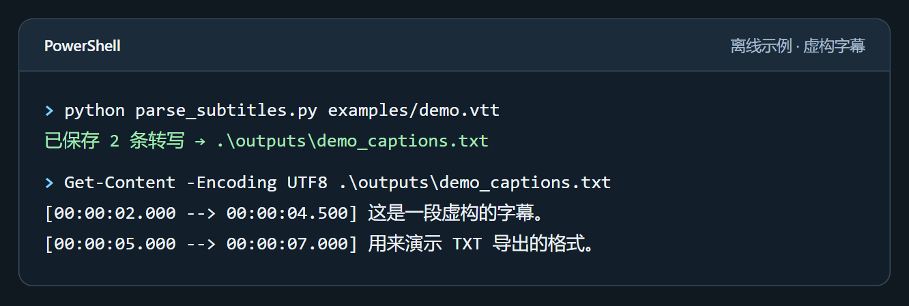

# 西农云课堂字幕导出

[**下载 ZIP**](https://github.com/dadaliu484-pixel/nwafu-classroom-captions/releases/latest/download/nwafu-classroom-captions.zip) · [版本说明](https://github.com/dadaliu484-pixel/nwafu-classroom-captions/releases/latest)

把西农云课堂回放里的「转写」保存为带时间戳的 UTF-8 文本。每次保存当前回放，适合课后查找课堂内容。

导出课堂转写需要能正常登录西农云课堂并查看对应回放。试用示例和转换本地字幕只需 Python。

## Windows 快速开始

1. 点击上方的 **下载 ZIP**，解压到可写目录。
2. 安装 [Python 3.10 或更新版本](https://www.python.org/downloads/windows/)，安装时勾选 **Add python.exe to PATH**。已安装可跳过。
3. 双击 **start.cmd**。首次启动会安装项目依赖并下载 Chromium。
4. 在弹出的浏览器里登录西农云课堂，进入 **课堂实录**，打开一节回放，等「转写」和总字数显示。
5. 切回命令窗口，按 **Enter**。字幕保存在项目的 **outputs** 文件夹里。要导出下一节，打开对应回放再按 **Enter**。输入 `q` 并按 **Enter** 退出。

## macOS 和 Linux

在解压后的项目目录运行以下命令。首次安装完成后，之后只需运行最后一行。

```sh
python3 -m venv .venv
.venv/bin/python -m pip install -r requirements.txt
.venv/bin/python -m playwright install --no-shell chromium
.venv/bin/python capture_subtitles.py
```

Linux 如果提示缺少系统库，参见 [Playwright 浏览器安装说明](https://playwright.dev/python/docs/browsers#install-system-dependencies)。

## 试用和转换本地字幕

使用虚构示例体验导出格式。此命令只需要 Python。

```sh
python parse_subtitles.py examples/demo.vtt
```

如果系统使用 `python3` 命令，请用它替换 `python`。运行成功后可打开 `outputs/demo_captions.txt`。



```text
[00:00:02.000 --> 00:00:04.500] 这是一段虚构的字幕。
[00:00:05.000 --> 00:00:07.000] 用来演示 TXT 导出的格式。
```

也可以传入本机的 SRT、VTT、带时间字段的 JSON，或包含「转写」标题及时间戳的页面文本。用 `--json-unit ms` 指定 JSON 中无单位的数字为毫秒，用 `--output` 指定输出文件名。

## 常见问题

- **找不到转写**。确认回放在当前浏览器标签页，转写已显示，浏览器窗口保持打开。有些回放在平台上没有转写。
- **退出后要重新登录**。浏览器使用临时会话。账号和密码在学校登录页面输入，工具把带时间戳的转写写入本机文件。
- **找不到导出的文件**。命令窗口会显示完整路径。请妥善存放课堂资料，分享前确认授权并检查字幕正文。

本项目采用 [MIT 许可证](LICENSE)。
